[README.md](https://github.com/user-attachments/files/32571592/README.md)
# Challenge 01 – Student Marks Card

**SRM University-AP | CSE 101 – Fundamentals of Computing and C Programming**
**30-Day C Programming Challenge**

## Problem Statement

Write a C program that reads the marks of a student in five subjects and prints the **total**, **average** and **percentage**. Each subject is out of 100, so the maximum total is 500.

## Algorithm

1. Start.
2. Declare integer variables `sub1` to `sub5` and `total`, and float variables `average` and `percentage`.
3. Read the marks of the five subjects from the user.
4. Calculate `total = sub1 + sub2 + sub3 + sub4 + sub5`.
5. Calculate `average = total / 5.0`.
6. Calculate `percentage = (total / 500.0) * 100.0`.
7. Display the total, average and percentage.
8. Stop.

## Source Code (`c1.c`)

```c
#include<stdio.h>
int main() {
int sub1,sub2,sub3,sub4,sub5,total;
float  average,percentage;
//print and scan five subjects marks//

printf("\n <<<<<<student marks card>>>>>>> ");

printf("\n enter subject1 marks");
scanf("%d",&sub1);
printf("\n enter subject2 marks");
scanf("%d",&sub2);
printf("\n enter subject3 marks");
scanf("%d",&sub3);
printf("\n enter subject4 marks");
scanf("%d",&sub4);
printf("\n enter subject5 marks");
scanf("%d",&sub5);

/*calculate the total of all five subjects
calculate the average
calculate the percentage*/

total=sub1+sub2+sub3+sub4+sub5;
printf("\n total marks of the student =%d",total);

average=total/5.0;
printf("\n average of the student =%.2f",average);

percentage=(total/500.0)*100.0;
printf("\n percentage of the student =%.2f",percentage);

return 0;
}
```

## How to Compile and Run

```bash
gcc c1.c -o c1
./c1
```

## Test Cases

| Test | Subject 1 | Subject 2 | Subject 3 | Subject 4 | Subject 5 | Total | Average | Percentage |
|------|-----------|-----------|-----------|-----------|-----------|-------|---------|------------|
| 1    | 80 | 75 | 90 | 85 | 70 | 400 | 80.00 | 80.00 |
| 2    | 65 | 72 | 68 | 75 | 80 | 360 | 72.00 | 72.00 |
| 3    | 95 | 85 | 92 | 90 | 85 | 447 | 89.40 | 89.40 |

## Sample Output

### Test Case 1

```
 <<<<<<student marks card>>>>>>> 
 enter subject1 marks80

 enter subject2 marks75

 enter subject3 marks90

 enter subject4 marks85

 enter subject5 marks70

 total marks of the student =400
 average of the student =80.00
 percentage of the student =80.00
```

### Test Case 2

```
 <<<<<<student marks card>>>>>>> 
 enter subject1 marks65

 enter subject2 marks72

 enter subject3 marks68

 enter subject4 marks75

 enter subject5 marks80

 total marks of the student =360
 average of the student =72.00
 percentage of the student =72.00
```

### Test Case 3

```
 <<<<<<student marks card>>>>>>> 
 enter subject1 marks95

 enter subject2 marks85

 enter subject3 marks92

 enter subject4 marks90

 enter subject5 marks85

 total marks of the student =447
 average of the student =89.40
 percentage of the student =89.40
```

## Author

- **Name:** JASWANTH . J
- **Registration No.:** AP26110090182


The input of the student marks card


The output of the student marks card


---

# Challenge 02 – TripCalc: Fuel & Trip Cost Calculator

**SRM University-AP | CSE 101 – Fundamentals of Computing and C Programming**
**30-Day C Programming Challenge**

## Problem Statement

Write a C program to read the total distance to be travelled (in kilometres), the vehicle's mileage (kilometres per litre), and the current fuel price per litre. Calculate and display the amount of fuel required for the trip and the total fuel cost.

## Algorithm

1. Start.
2. Declare float variables `distance`, `mileage` and `price`, and float variables `fuel_required` and `total_cost`.
3. Read the total distance of the trip, the vehicle's mileage and the fuel price per litre from the user.
4. Calculate `fuel_required = distance / mileage`.
5. Calculate `total_cost = fuel_required * price`.
6. Display the fuel required and the total fuel cost.
7. Stop.

## Source Code (`c2.c`)

```c
#include<stdio.h>
int main() {
float distance,mileage,price;
float fuel_required,total_cost;
//print and scan the trip details//

printf("\n <<<<<<TripCalc>>>>>>> ");

printf("\n enter total distance of the trip (in km)");
scanf("%f",&distance);
printf("\n enter vehicle mileage (km per litre)");
scanf("%f",&mileage);
printf("\n enter fuel price per litre");
scanf("%f",&price);

/*calculate the fuel required for the trip
calculate the total fuel cost*/

fuel_required=distance/mileage;
printf("\n total fuel required for the trip =%.2f litres",fuel_required);

total_cost=fuel_required*price;
printf("\n total fuel cost of the trip =Rs.%.2f",total_cost);

return 0;
}
```

## How to Compile and Run

```bash
gcc c2.c -o c2
./c2
```

## Test Cases

| Test | Distance (km) | Mileage (km/L) | Price (Rs./L) | Fuel Required (L) | Total Cost (Rs.) |
|------|---------------|----------------|----------------|--------------------|-------------------|
| 1    | 240 | 20 | 100 | 12.00 | 1200.00 |
| 2    | 300 | 15 | 105 | 20.00 | 2100.00 |
| 3    | 180 | 18 | 95 | 10.00 | 950.00 |

## Sample Output

### Test Case 1

```
 <<<<<<TripCalc>>>>>>> 
 enter total distance of the trip (in km)240

 enter vehicle mileage (km per litre)20

 enter fuel price per litre100

 total fuel required for the trip =12.00 litres
 total fuel cost of the trip =Rs.1200.00
```

### Test Case 2

```
 <<<<<<TripCalc>>>>>>> 
 enter total distance of the trip (in km)300

 enter vehicle mileage (km per litre)15

 enter fuel price per litre105

 total fuel required for the trip =20.00 litres
 total fuel cost of the trip =Rs.2100.00
```

### Test Case 3

```
 <<<<<<TripCalc>>>>>>> 
 enter total distance of the trip (in km)180

 enter vehicle mileage (km per litre)18

 enter fuel price per litre95

 total fuel required for the trip =10.00 litres
 total fuel cost of the trip =Rs.950.00
```

## Author

- **Name:** JASWANTH . J
- **Registration No.:** AP26110090182
INPUT 
- 

OUTPUT


---

# Challenge 03 – SmartCart: Discount & Delivery Calculator

**SRM University-AP | CSE 101 – Fundamentals of Computing and C Programming**
**30-Day C Programming Challenge**

## Problem Statement

A student is purchasing items from an online store. Read the purchase amount, the customer type (1 = Student, 2 = Regular Customer) and the delivery distance in kilometres. Determine the discount and the delivery charge using conditional statements, and display the purchase amount, discount amount, amount after discount, delivery charge and final payable amount.

### Discount Rules

| Condition | Discount |
|-----------|----------|
| Student + Purchase ≥ Rs.2000 | 15% |
| Student + Purchase < Rs.2000 | 10% |
| Regular + Purchase ≥ Rs.3000 | 8% |
| Regular + Purchase < Rs.3000 | 0% |

### Delivery Rules

| Distance | Delivery Charge |
|----------|-----------------|
| ≤ 5 km | Rs.40 |
| > 5 km and ≤ 15 km | Rs.70 |
| > 15 km | Rs.100 |

## Algorithm

1. Start.
2. Declare `purchaseamount` and `distance` as floats, `customertype` as an integer, and `discount_percent`, `discount_amount`, `amount_after_discount`, `delivery_charge` and `final_payable` as floats initialised to 0.0.
3. Read the purchase amount, the customer type (1 = Student, 2 = Regular Customer) and the delivery distance in km.
4. If the customer type is 1 and the purchase amount ≥ 2000 set the discount to 15%; if the purchase amount < 2000 set it to 10%.
5. If the customer type is 2 and the purchase amount ≥ 3000 set the discount to 8%; if the purchase amount < 3000 set it to 0%. For any other customer type print "Invalid customer" and set the discount to 0%.
6. Calculate `discount_amount = (discount_percent / 100.0) * purchaseamount` and `amount_after_discount = purchaseamount - discount_amount`.
7. If the distance ≤ 5 km the delivery charge is Rs.40; else if the distance ≤ 15 km it is Rs.70; otherwise it is Rs.100.
8. Calculate `final_payable = amount_after_discount + delivery_charge`, display all the values with two decimals, and stop.

## Source Code (`c3.c`)

```c
#include <stdio.h>

int main() {
    float purchaseamount, distance;
    int customertype;
    float discount_percent = 0.0, discount_amount = 0.0;
    float amount_after_discount = 0.0, delivery_charge = 0.0, final_payable = 0.0;

    printf("Enter purchase amount : ");
    scanf("%f", &purchaseamount);

    printf("Enter customer type (1 = Student, 2 = Regular Customer): ");
    scanf("%d", &customertype);

    printf("Enter delivery distance  ");
    scanf("%f", &distance);

    if (customertype == 1) {
        if (purchaseamount >= 2000) {
            discount_percent = 15.0;
        } else {
            discount_percent = 10.0;
        }
    } else if (customertype == 2) {
        if (purchaseamount >= 3000) {
            discount_percent = 8.0;
        } else {
            discount_percent = 0.0;
        }
    } else {
        printf("Invalid customer \n");
        discount_percent = 0.0;
    }

    discount_amount = (discount_percent / 100.0) * purchaseamount;
    amount_after_discount = purchaseamount - discount_amount;

    if (distance <= 5.0) {
        delivery_charge = 40.0;
    } else if (distance > 5.0 && distance <= 15.0) {
        delivery_charge = 70.0;
    } else {
        delivery_charge = 100.0;
    }

    final_payable = amount_after_discount + delivery_charge;

    printf("Purchase Amount:     %.2f\n", purchaseamount);
    printf("Discount Amount:     %.2f (%f%%)\n", discount_amount, discount_percent);
    printf("Amount After Discount:%.2f\n", amount_after_discount);
    printf("Delivery Charge:     %.2f\n", delivery_charge);
    printf("Final Payable Amount: %.2f\n", final_payable);

    return 0;
}
```

## How to Compile and Run

```bash
gcc c3.c -o c3
./c3
```

## Test Cases

All six test cases were executed on the program and the outputs matched the expected results.

| TC | Purchase (Rs.) | Customer Type | Distance (km) | Discount (%) | Discount (Rs.) | Amount After Discount (Rs.) | Delivery (Rs.) | Final Payable (Rs.) | Result |
|------|------|------|------|------|------|------|------|------|------|
| TC01 | 2500 | Student | 20 | 15 | 375.00 | 2125.00 | 100.00 | 2225.00 | Pass |
| TC02 | 3500 | Regular | 10 | 8 | 280.00 | 3220.00 | 70.00 | 3290.00 | Pass |
| TC03 | 3000 | Student | 25 | 15 | 450.00 | 2550.00 | 100.00 | 2650.00 | Pass |
| TC04 | 2000 | Student | 4 | 15 | 300.00 | 1700.00 | 40.00 | 1740.00 | Pass |
| TC05 | 6000 | Regular | 16 | 8 | 480.00 | 5520.00 | 100.00 | 5620.00 | Pass |
| TC06 | 1500 | Student | 2 | 10 | 150.00 | 1350.00 | 40.00 | 1390.00 | Pass |

## Sample Output

### Test Case 1 – Purchase 2500, Student, 20 km

```
Enter purchase amount : 2500
Enter customer type (1 = Student, 2 = Regular Customer): 1
Enter delivery distance  20
Purchase Amount:     2500.00
Discount Amount:     375.00 (15.000000%)
Amount After Discount:2125.00
Delivery Charge:     100.00
Final Payable Amount: 2225.00
```

### Test Case 2 – Purchase 3500, Regular, 10 km

```
Enter purchase amount : 3500
Enter customer type (1 = Student, 2 = Regular Customer): 2
Enter delivery distance  10
Purchase Amount:     3500.00
Discount Amount:     280.00 (8.000000%)
Amount After Discount:3220.00
Delivery Charge:     70.00
Final Payable Amount: 3290.00
```

### Test Case 3 – Purchase 3000, Student, 25 km

```
Enter purchase amount : 3000
Enter customer type (1 = Student, 2 = Regular Customer): 1
Enter delivery distance  25
Purchase Amount:     3000.00
Discount Amount:     450.00 (15.000000%)
Amount After Discount:2550.00
Delivery Charge:     100.00
Final Payable Amount: 2650.00
```

### Test Case 4 – Purchase 2000, Student, 4 km

```
Enter purchase amount : 2000
Enter customer type (1 = Student, 2 = Regular Customer): 1
Enter delivery distance  4
Purchase Amount:     2000.00
Discount Amount:     300.00 (15.000000%)
Amount After Discount:1700.00
Delivery Charge:     40.00
Final Payable Amount: 1740.00
```

### Test Case 5 – Purchase 6000, Regular, 16 km

```
Enter purchase amount : 6000
Enter customer type (1 = Student, 2 = Regular Customer): 2
Enter delivery distance  16
Purchase Amount:     6000.00
Discount Amount:     480.00 (8.000000%)
Amount After Discount:5520.00
Delivery Charge:     100.00
Final Payable Amount: 5620.00
```

### Test Case 6 – Purchase 1500, Student, 2 km

```
Enter purchase amount : 1500
Enter customer type (1 = Student, 2 = Regular Customer): 1
Enter delivery distance  2
Purchase Amount:     1500.00
Discount Amount:     150.00 (10.000000%)
Amount After Discount:1350.00
Delivery Charge:     40.00
Final Payable Amount: 1390.00
```


## Author

- **Name:** JASWANTH . J
- **Registration No.:** AP26110090182
- **Date:** 11-10-2026
- **GitHub:** [github.com/BOLDGLOBE](https://github.com/BOLDGLOBE)
- **LinkedIn:** [linkedin.com/in/jaswanth-joga-2baa74423](https://www.linkedin.com/in/jaswanth-joga-2baa74423/)


The code of the SmartCart program


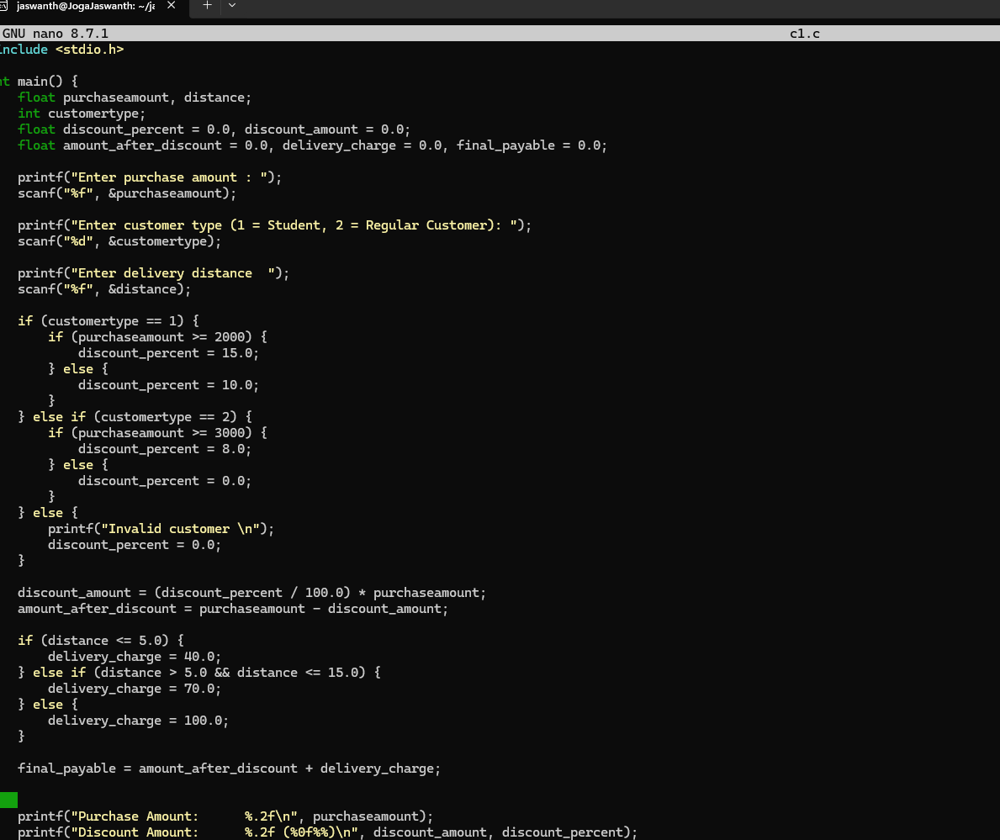


The output of the six test cases


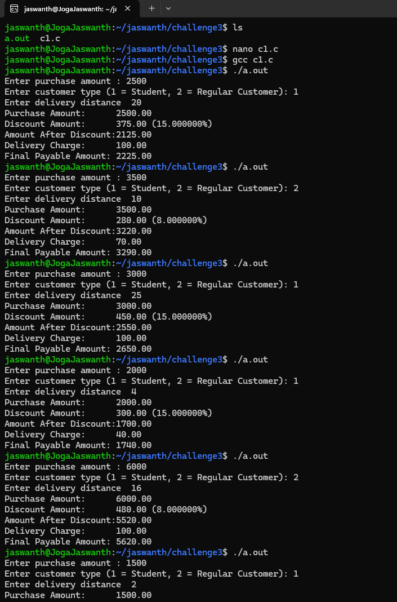

---

# Challenge 05 – Equation Solver+

**SRM University-AP | CSE 101 – Fundamentals of Computing and C Programming**
**30-Day C Programming Challenge**

## Problem Statement

Write a menu-driven C program that lets a user choose a mathematical operation. After each operation, display the menu again. The program must stop only when the user selects Exit.

| Choice | Operation | What the program must do |
|------|------|------|
| 1 | Solve a linear equation (ax+b=0) | Calculate x, or identify no solution / infinitely many solutions |
| 2 | Calculate factorial (n!) | Calculate factorial using a loop. Accept integers from 0 to 12 only |
| 3 | Solve a quadratic equation (ax^2+bx+c=0) | Use the discriminant to identify the type of roots and calculate real roots |
| 4 | Exit | Display a closing message and terminate the program |

 ## Algorithm / Pseudocode:
1. Start .
2. Declare variables choice ,linear, factorial ,quadratic .
3. Start a loop with do while that continues till the users enters exit .
4. MENUOPTIONS -1.solvelinear , 2.calculatefactorial, 3.solvequadratic, 4.exit.
5. As the linear equation (ax+b=0), factorial=(n!),quadratic quadratic equation (ax^2+bx+c).
6. Read all the input from the user and stores at choice.
7. At case 1(linear equation )-read the values of a and b,uses the condition if (a!=0) then x=-b/a,then said to be linear .
8. Or a=0 and b=0 said to be infinitely many solutions or a=0 and b not equal to 0 said to be no solutions .
9. At case 2(factorial)-read the n value,use the condition if and else
10. The n value between 0 to 12 then the output gets the factorial accordingly the n value given by the user .
11. At case 3(quadratic equation )-read the values of a,b,c and roots 1 and 2 and discriminant.
12. Calculate the discriminant=b^2-4ac.
13. If discriminant is greater then 0 then two real roots are calculated ,else if discriminant =0 then only one real root is calculated else discriminant is less then 0 then no real solutions are calculated .
14. At case 4(exit)-prints that you have exited the program.
15. At case 5-prints you have entered thee invalid option.
16. Stop .
17.

## Source Code (`c5.c`)

```c
#include<stdio.h>
#include<math.h>

void  MENUOPTIONS();
void solvelinear();
void calculatefactorial();
void solvequadratic();

int main() {

int choice;
do{
MENUOPTIONS();
scanf("%d",&choice);

switch(choice) {
case 1:
solvelinear();
break;
case 2:
calculatefactorial();
break;
case 3:
solvequadratic();
break;
case 4:
printf("\n you have exit  the programm");
break;

case 5:
printf("\n you have entered the wrong option ");
break;
}
}while(choice!=4);
return 0;
}

void MENUOPTIONS() {
printf("\n <<<<<<<<<<<<< >>>>>>>>>>>");

 printf("\n 1. slovelinear ");
printf("\n  linear equation (ax+b=0)");

 printf("\n 2. calculatefactorial");
printf("\n  factorial for the entered number  (n!)");

 printf("\n 3. solvequadratic");
printf("\n  quadratic equation (ax^2+bx+c=0)");
printf("\n 4. exit");
printf("\n enter your choice");
}

void solvelinear() {
int a,b,x;
printf("\n enter the values of a,b");
printf("\n enter a=");
scanf("%d",&a);
printf("\n enter b=");
scanf("%d",&b);

//now checking the conditions as linear,infinitely many  or  no soltions//

if(a!=0){
x=-b/a;
printf("\n linear solution:x=%d",x);
}else if(a==0 && b==0){
printf("\n infinitely many solutions");
}
else if(a==0 && b!=0){
printf("\n no solution ");
}
}

void calculatefactorial() {
int n;
printf("\n enter the digits(0-12):");
scanf("%d",&n);
if(n<0 || n>12){
printf("\n digits must be entered between 0 - 12");
}
else{

int fact =1;
for (int i=1;i<=n;i++){
fact *= i;
}
printf("\n %d! =%d",n,fact);
}
}

void solvequadratic() {
double a,b,c;
 double discriminant,root1,root2;
printf("\n enter the values of a , b and c");

printf("\n  enter the value of a=");

scanf("%lf",&a);
printf("\n enter the value of b=");

scanf("\n %lf",&b);
printf("\n enter the value of c=");

scanf("\n %lf",&c);

if (a == 0){
printf("\n not a quadratic equation ");
}
else{
discriminant =(b*b)-(4*a*c);
 if (discriminant>0){
printf("\n two distinct real roots ");
 // checking what are the  two roots //
root1=(-b+sqrt(discriminant))/(2*a);
root2=(-b-sqrt(discriminant))/(2*a);
printf("\n root1=%.2lf,root2=%.2lf",root1,root2);
}else if (discriminant == 0){
printf("\n two equal roots ");
root1=-b/(2*a);
printf("\n root1=root2=%.2lf",root1);
}
else{
printf("\n  no real roots ");
}
}
}
```

## How to Compile and Run

```bash
gcc c5.c -o c5 -lm
./c5
```

## Test Cases

All eight test cases from the Challenge 05 submission sheet were executed on the program and the outputs matched the expected results.

| TC | Operation | Input | Expected Output | Result |
|------|------|------|------|------|
| TC01 | Linear: one solution | a = 2, b = -8 | x = 4 | Pass |
| TC02 | Linear: no solution | a = 0, b = 5 | no solution | Pass |
| TC03 | Factorial | n = 5 | 120 | Pass |
| TC04 | Factorial boundary | n = 0 | 1 | Pass |
| TC05 | Quadratic: D > 0 | a = 1, b = -3, c = 2 | roots 1 and 2 | Pass |
| TC06 | Quadratic: D = 0 | a = 1, b = -2, c = 1 | root 1 | Pass |
| TC07 | Quadratic: D < 0 | a = 1, b = 0, c = 1 | no real roots | Pass |
| TC08 | Invalid menu choice | 5 (outside 1-4) | you have entered the wrong option | Pass |

## Sample Output

The menu is displayed before every choice. It is shown in full for Test Case 1 and abbreviated afterwards.

### Test Case 1 - Linear equation: a = 2, b = -8

```
 <<<<<<<<<<<<< >>>>>>>>>>> 
 1. slovelinear 
  linear equation (ax+b=0)
 2. calculatefactorial
  factorial for the entered number  (n!)
 3. solvequadratic
  quadratic equation (ax^2+bx+c=0)
 4. exit
 enter your choice1
 enter the values of a,b
 enter a=2
 enter b=-8
 linear solution:x=4
...menu displayed again...
 enter your choice4
 you have exit  the programm
```

### Test Case 2 - Linear equation: a = 0, b = 5

```
 enter the values of a,b
 enter a=0
 enter b=5
 no solution 
...menu displayed again...
 enter your choice4
 you have exit  the programm
```

### Test Case 3 - Factorial: n = 5

```
 enter the digits(0-12):5
 5! =120
```

### Test Case 4 - Factorial boundary: n = 0

```
 enter the digits(0-12):0
 0! =1
```

### Test Case 5 - Quadratic equation: a = 1, b = -3, c = 2 (D > 0)

```
 enter the values of a , b and c
 enter the value of a=1
 enter the value of b=-3
 enter the value of c=2
 two distinct real roots 
 root1=2.00,root2=1.00
```

### Test Case 6 - Quadratic equation: a = 1, b = -2, c = 1 (D = 0)

```
 enter the values of a , b and c
 enter the value of a=1
 enter the value of b=-2
 enter the value of c=1
 two equal roots 
 root1=root2=1.00
```

### Test Case 7 - Quadratic equation: a = 1, b = 0, c = 1 (D < 0)

```
 enter the values of a , b and c
 enter the value of a=1
 enter the value of b=0
 enter the value of c=1
 no real roots 
```

### Test Case 8 - Invalid menu choice

```
 enter your choice5
 you have entered the wrong option 
...menu displayed again...
 enter your choice4
 you have exit  the programm
```

## Author

- **Name:** JASWANTH . J
- **Registration No.:** AP26110090182
- **GitHub:** [github.com/BOLDGLOBE](https://github.com/BOLDGLOBE)
- **LinkedIn:** [linkedin.com/in/jaswanth-joga-2baa74423](https://www.linkedin.com/in/jaswanth-joga-2baa74423/)
The code of the Equation Solver+ program


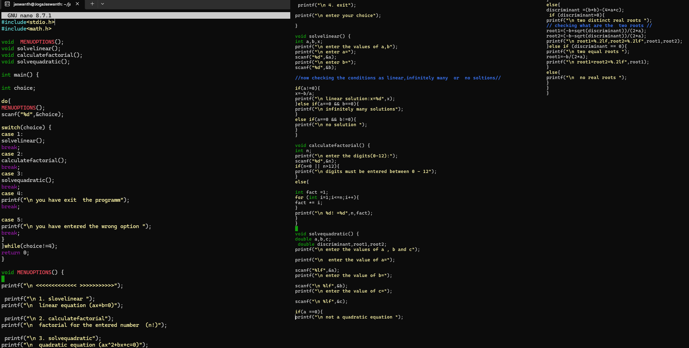
# Challenge 06 – Pattern Detective

**SRM University-AP | CSE 101 – Fundamentals of Computing and C Programming**
**30-Day C Programming Challenge**

## Problem Statement

A smart-campus activity monitor records the number of visits over several time slots. Read N activity readings into a one-dimensional array and complete every pattern task: display the readings, calculate statistics, find the second-largest distinct value, count local peaks, find the longest increasing run, rotate the array in place by K (no second array), and count how many rotated values are divisible by D = (R % 9) + 1, where R is the last two digits of the registration number.

N must be between 5 and 12 inclusive and each reading from 0 to 1000 inclusive. Invalid N or readings are asked again until valid.

## Algorithm

1. Validate and Input N: Prompt the user to enter a number N between 5 and 12, repeating until valid.
2. Fill Array Safely: Read N integer readings from the user, forcing a re-entry if any value falls outside 0 to 1000.
3. Print Original Array: Loop through the array from the first index to the last to display all entered elements.
4. Calculate Stats: Find the sum, average, minimum, and maximum values across all array elements.
5. Find Second Distinct Largest: Scan the array to find the highest value that is strictly less than the maximum element. If none exists, display a clear message.
6. Count Local Peaks: Count elements (excluding the first and last indices) that are strictly greater than both immediate neighbours.
7. Find Longest Growing Streak: Track the maximum length of consecutive elements where each value is strictly greater than the previous one.
8. Normalize Shift K: Input a shift value K, reducing it using K % N and adjusting negative values to positive equivalents.
9. Rotate In-Place: Reverse the full array, reverse the first K elements, and reverse the rest to shift it without a second array.
10. Check Final Divisibility: Calculate the divisor D = (R % 9) + 1 from the registration digits and count how many rotated array elements divide evenly by D.

## Source Code (`c6.c`)

```c
#include <stdio.h>

int main() {
    int N;
    int arr[12];
    do {
        printf("Enter the number of readings (5 to 12): ");
        scanf("%d", &N);
        if (N < 5 || N > 12) {
            printf("Invalid input! N must be between 5 and 12.\n");
        }
    } while (N < 5 || N > 12);

    for (int i = 0; i < N; i++) {
        do {
            printf("Enter reading %d (0 to 1000): ", i + 1);
            scanf("%d", &arr[i]);
            if (arr[i] < 0 || arr[i] > 1000) {
                printf("Invalid reading! Must be between 0 and 1000.\n");
            }
        } while (arr[i] < 0 || arr[i] > 1000);
    }

    printf("\n--- Task 1: Original Readings ---\n");
    printf("Readings: ");
    for (int i = 0; i < N; i++) {
        printf("%d ", arr[i]);
    }
    printf("\n");

    printf("\n--- Task 2: Basic Statistics ---\n");
    int sum = 0;
    int min = arr[0];
    int max = arr[0];

    for (int i = 0; i < N; i++) {
        sum += arr[i];
        if (arr[i] < min) min = arr[i];
        if (arr[i] > max) max = arr[i];
    }
    double average = (double)sum / N;

    printf("Sum: %d\n", sum);
    printf("Average: %.2f\n", average);
    printf("Minimum: %d\n", min);
    printf("Maximum: %d\n", max);

    printf("\n--- Task 3: Second-Largest Distinct Value ---\n");
    int second_max = -1;
    int found_second = 0;

    for (int i = 0; i < N; i++) {
        if (arr[i] < max) {
            if (!found_second || arr[i] > second_max) {
                second_max = arr[i];
                found_second = 1;
            }
        }
    }

    if (found_second) {
        printf("Second-largest distinct value: %d\n", second_max);
    } else {
        printf("No second-largest distinct value exists.\n");
    }

    printf("\n--- Task 4: Local Peaks ---\n");
    int peak_count = 0;
    for (int i = 1; i < N - 1; i++) {
        if (arr[i] > arr[i - 1] && arr[i] > arr[i + 1]) {
            peak_count++;
        }
    }
    printf("Total local peaks: %d\n",peak_count);

    printf("\n--- Task 5: Longest Increasing Run ---\n");
    int max_run = 1;
    int current_run = 1;

    for (int i = 1; i < N; i++) {
        if (arr[i] > arr[i - 1]) {
            current_run++;
        } else {
            if (current_run > max_run) {
                max_run = current_run;
            }
            current_run = 1;
        }
    }
    if (current_run > max_run) {
        max_run = current_run;
    }
    printf("Length of the longest strictly increasing run: %d\n", max_run);

    printf("\n--- Task 6: In-place Array Rotation ---\n");
    int K;
    printf("Enter integer K to rotate: ");
    scanf("%d", &K);

    int eff_K = (K % N + N) % N;

    if (eff_K > 0) {
        // Step 1: Reverse the entire array
        for (int i = 0; i < N / 2; i++) {
            int temp = arr[i];
            arr[i] = arr[N - 1 - i];
            arr[N - 1 - i] = temp;
        }
        // Step 2: Reverse the first eff_K elements
        for (int i = 0; i < eff_K / 2; i++) {
            int temp = arr[i];
            arr[i] = arr[eff_K - 1 - i];
            arr[eff_K - 1 - i] = temp;
        }
        // Step 3: Reverse the remaining N - eff_K elements
        for (int i = 0; i < (N - eff_K) / 2; i++) {
            int temp = arr[eff_K + i];
            arr[eff_K + i] = arr[N - 1 - i];
            arr[N - 1 - i] = temp;
        }
    }

    printf("Rotated array: ");
    for (int i = 0; i < N; i++) {
        printf("%d ", arr[i]);
    }
    printf("\n");

    printf("\n--- Task 7: Registration Divisibility Check ---\n");
    int R;
    printf("Enter the last two digits of your registration number: ");
    scanf("%d", &R);

    int D = (R % 9) + 1;
    int divisible_count = 0;
    for (int i = 0; i < N; i++) {
        if (arr[i] % D == 0) {
            divisible_count++;
        }
    }
    printf("Calculated Value D = %d\n", D);
    printf("Count of values divisible by D in the rotated array: %d\n", divisible_count);

    return 0;
}
```

## How to Compile and Run

```bash
gcc c6.c -o c6
./c6
```

## Test Cases

All eight test cases from the Challenge 06 submission sheet were executed on the program and the outputs matched the expected results. R is the last two digits of the registration number (82), so D = (82 % 9) + 1 = 2.

| TC | Scenario | Input / Expected Behaviour | Result |
|------|------|------|------|
| TC01 | Ordinary sequence | 12, 7, 18, 25, 11 with K = 2 — sum 73, average 14.60, min 7, max 25 | Pass |
| TC02 | Repeated maximum | 4, 9, 6, 9, 2 with K = 0 — second-largest distinct value is 6 | Pass |
| TC03 | All values equal | 5, 5, 5, 5, 5 — no second-largest distinct value; peak count 0 | Pass |
| TC04 | Strictly decreasing | 9, 8, 7, 6, 5 with K = -1 — increasing-run length is 1; left rotation works | Pass |
| TC05 | Local peaks | 2, 7, 3, 8, 4 — peak count is 2 (7 and 8) | Pass |
| TC06 | Rotation | 1, 2, 3, 4, 5 with K = 2 — rotated array 4 5 1 2 3 (K = 0 and negative K covered by TC02/TC04) | Pass |
| TC07 | Personalised divisor | R = 82 → D = 2 — count of values divisible by D after rotation | Pass |
| TC08 | Invalid input | N = 2 and N = 15 rejected; reading 2000 and -5 rejected; re-asked until valid | Pass |

## Test Case Screenshots

### Test Case 1 – Ordinary sequence
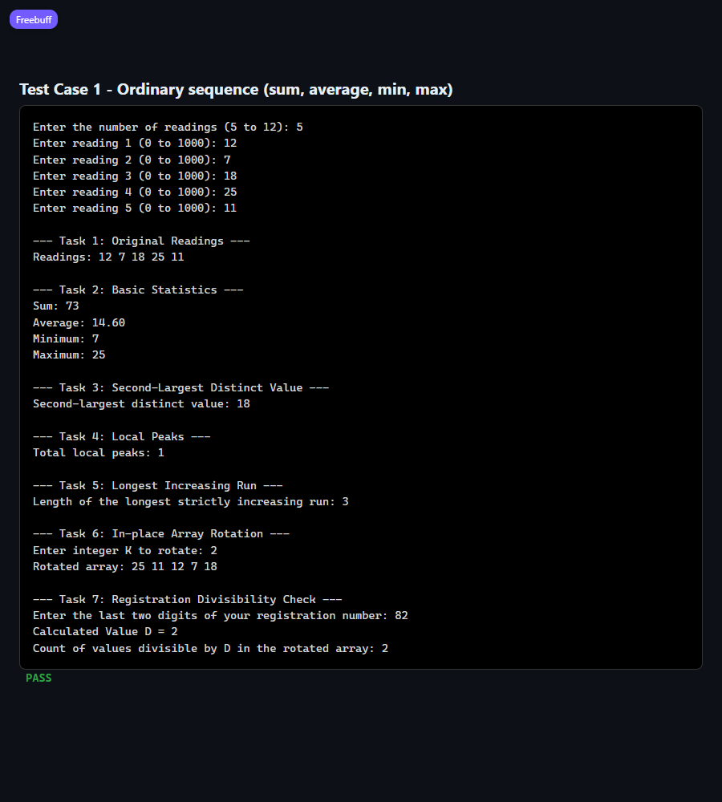

### Test Case 2 – Repeated maximum
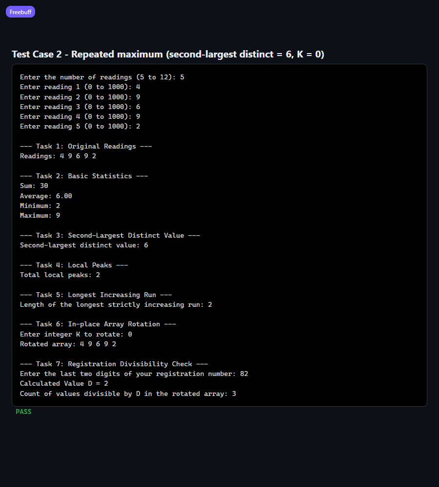

### Test Case 3 – All values equal
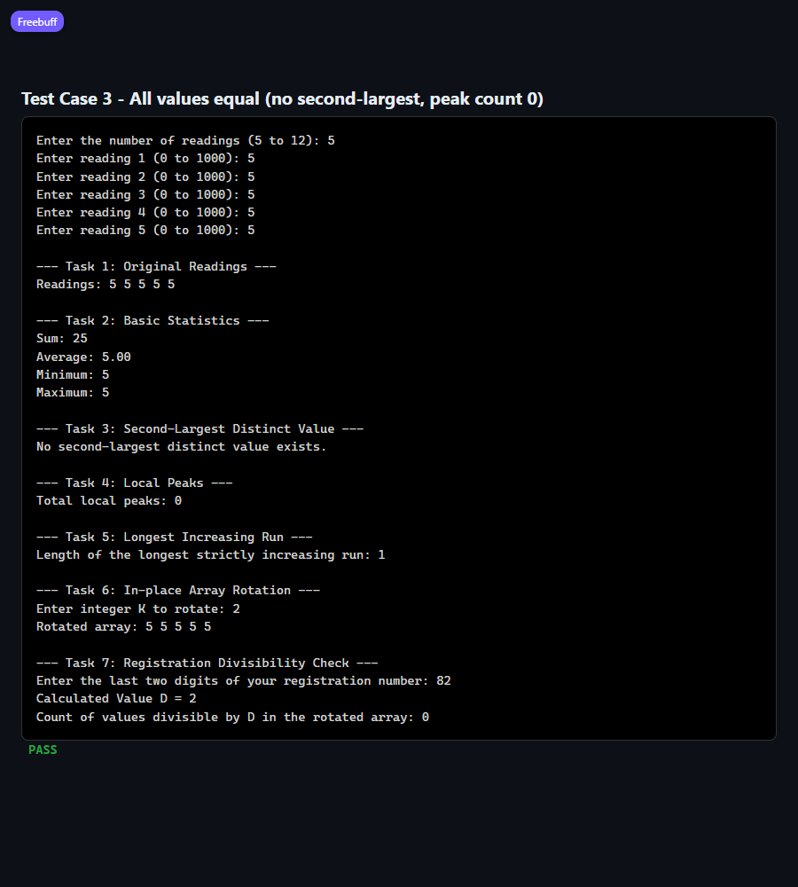

### Test Case 4 – Strictly decreasing
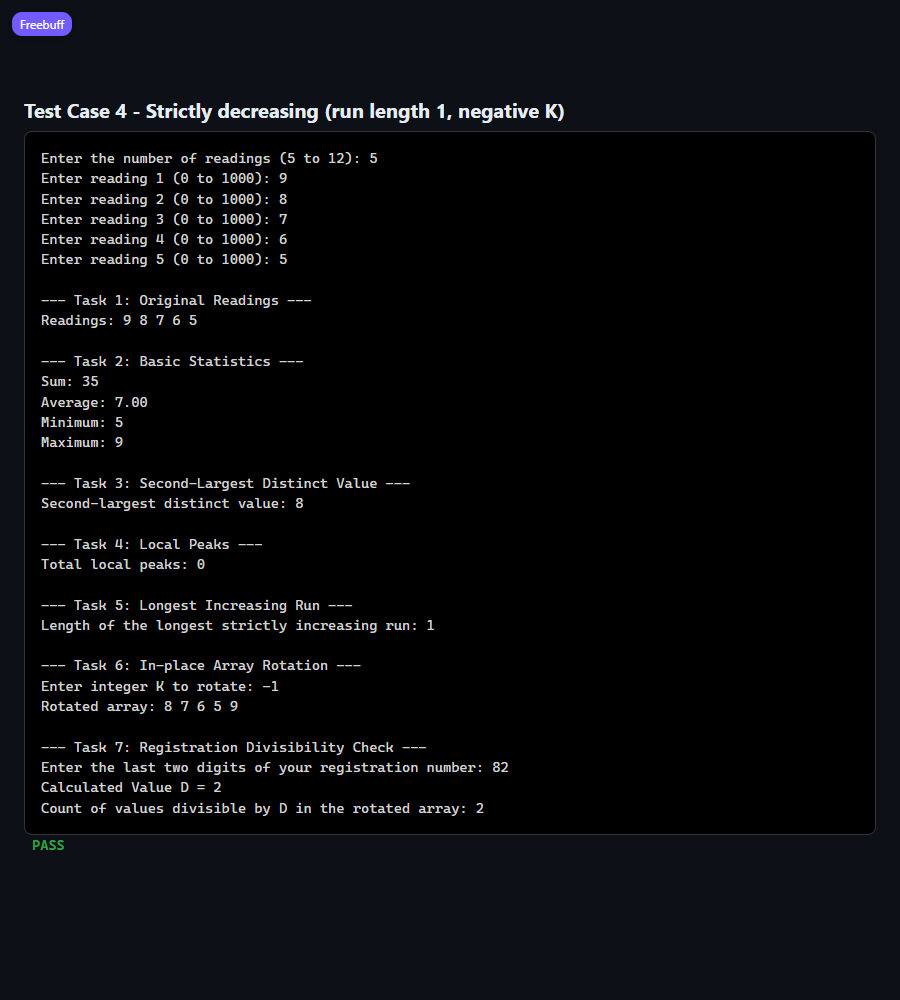

### Test Case 5 – Local peaks
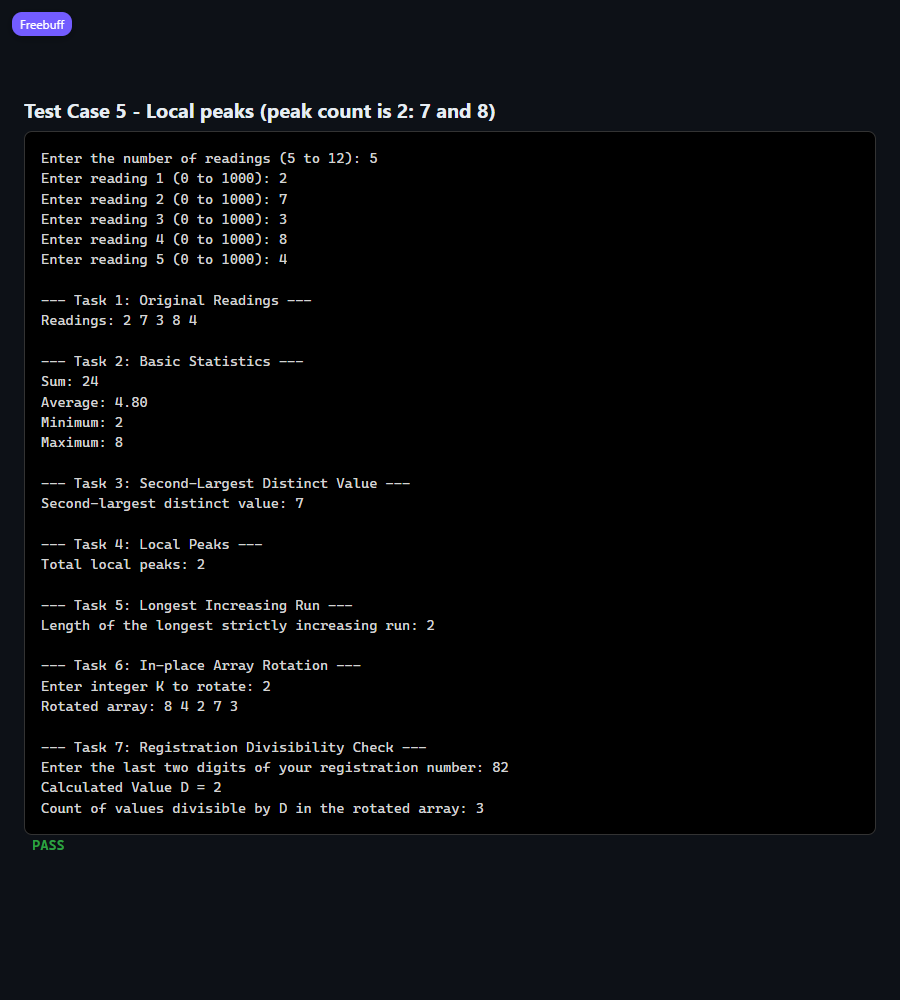

### Test Case 6 – Rotation
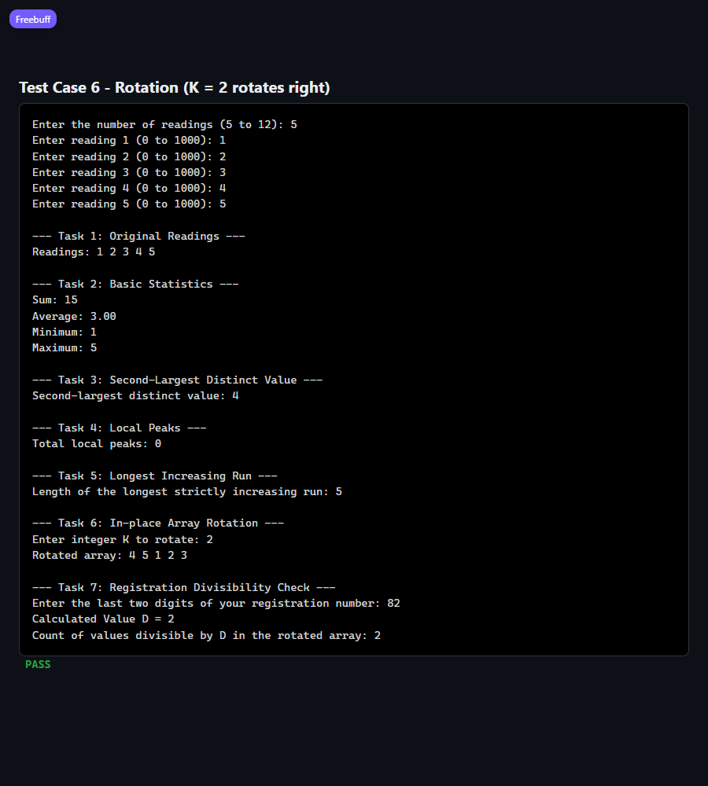

### Test Case 7 – Personalised divisor
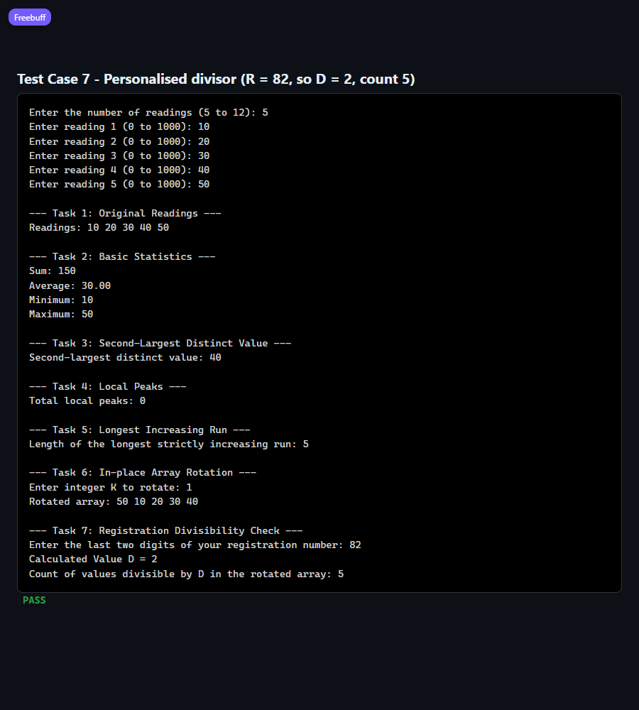

### Test Case 8 – Invalid input
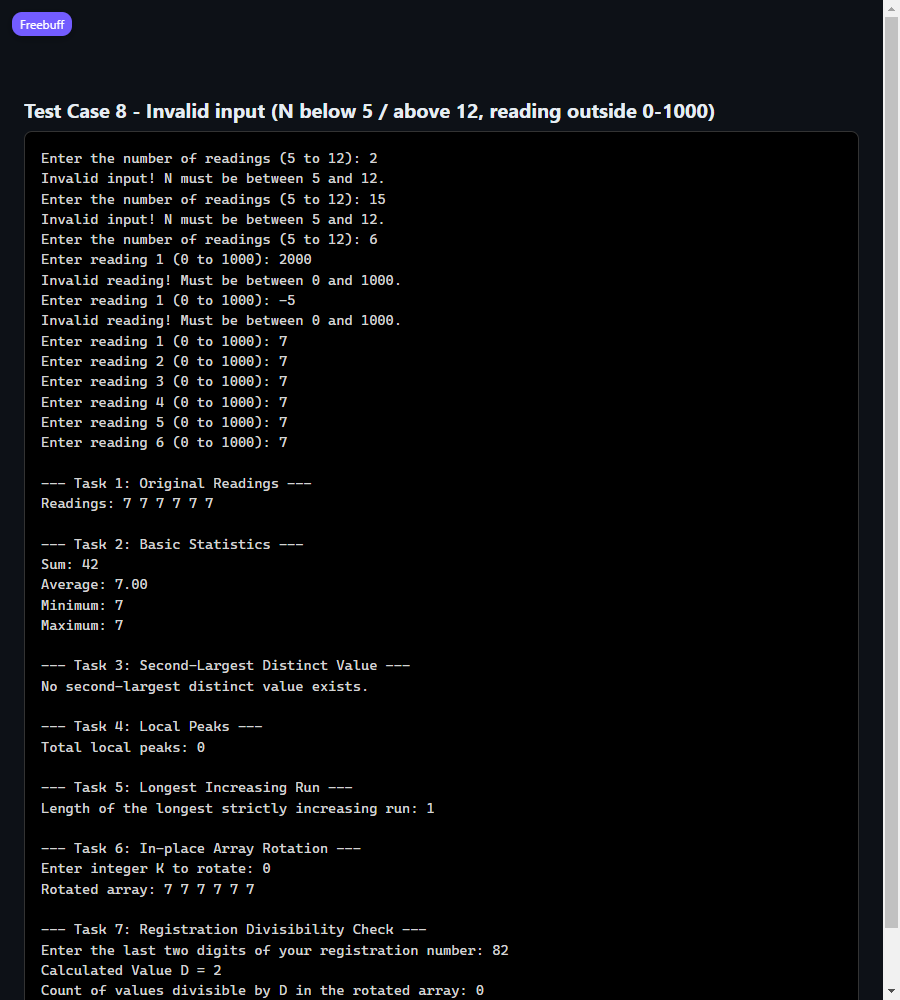

## Author

- **Name:** JASWANTH . J
- **Registration No.:** AP26110090182

The code of the Pattern Detective program

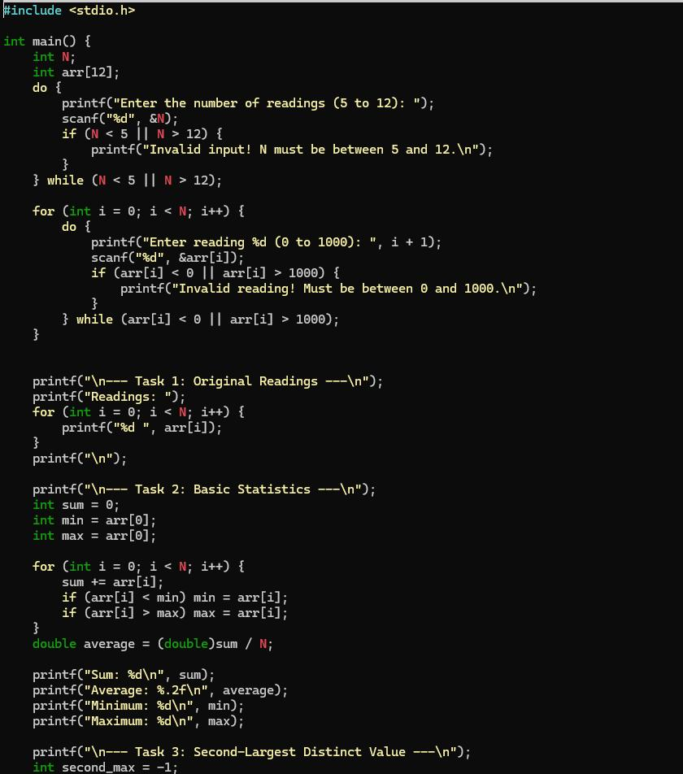

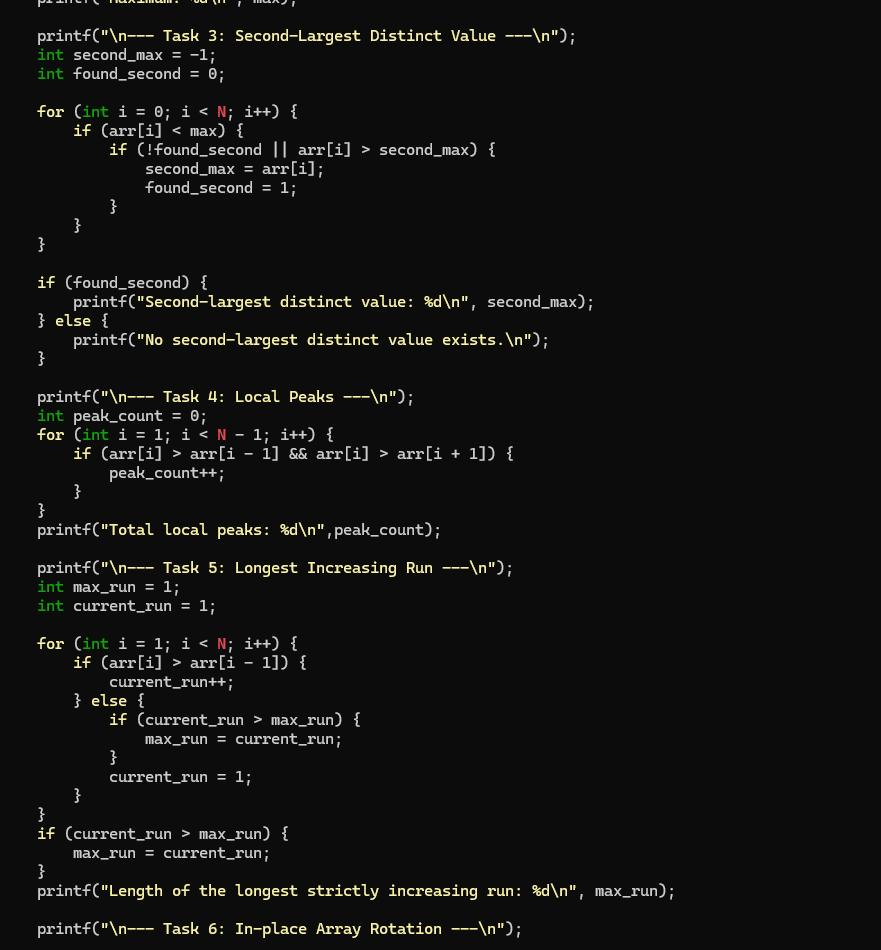

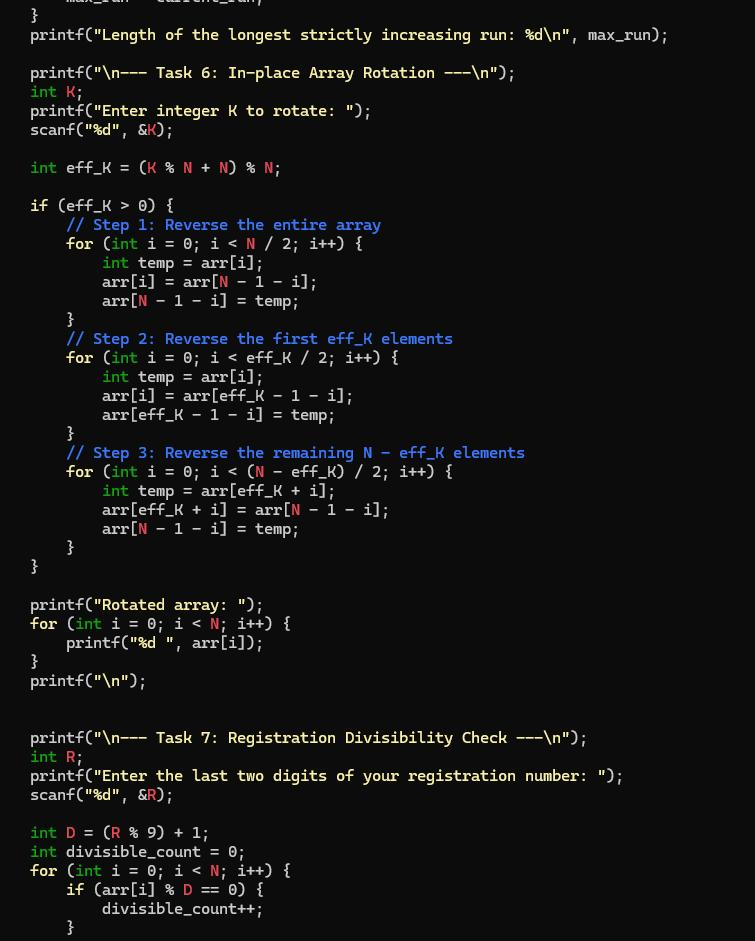

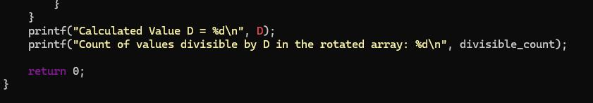
